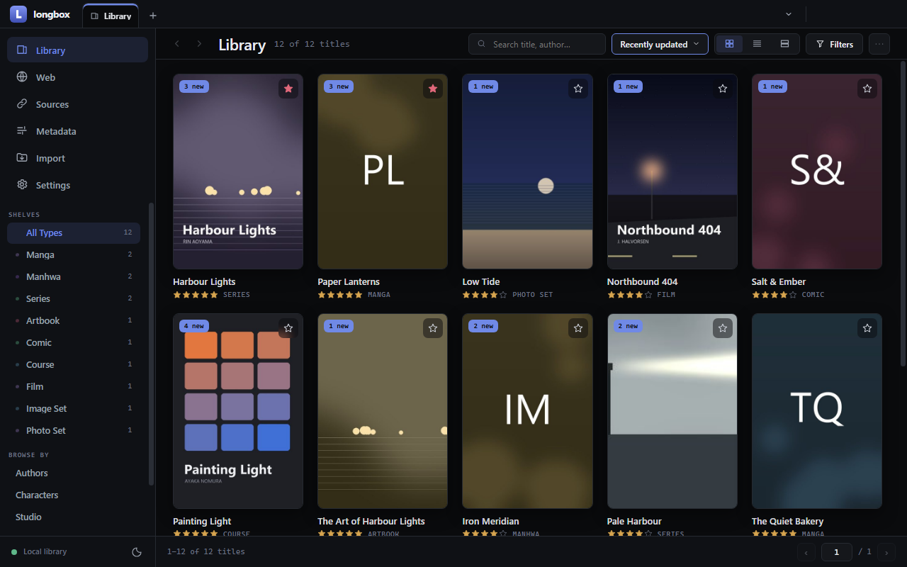

# longbox

**A local-first media vault for your desktop, with a browser built in to bring things home.**

Manga, manhwa and comics, series, films and courses, photo sets and artbooks live side by side in a
plain folder you own, on any disk you like — under one set of fields, filters and pages, organized,
searchable and offline. Browse the sites you already use in the built-in browser, and longbox files
what you bring home. No account, no cloud, no server to run.

**[Download](https://github.com/witalic/longbox/releases/latest)** ·
[Install and get started](https://witalic.github.io/longbox/#start) ·
[Project page](https://witalic.github.io/longbox/) · [User guide](docs/guide.md) ·
[Changelog](CHANGELOG.md)

longbox ships no content and no code for any particular website — no scrapers, no source
catalogs, no online metadata services. What you keep in your vault is yours to answer for.

## How it is built

longbox is designed, directed and tested by one person, [witalic](https://github.com/witalic), and
written largely with Claude Code, Anthropic's AI coding assistant; the commits it co-wrote say so,
and the rules it works by are public in [CLAUDE.md](CLAUDE.md) and [.claude/rules/](.claude/rules/).
Contributions are welcome: see [CONTRIBUTING.md](CONTRIBUTING.md).

## License

[GPL-3.0-or-later](LICENSE). The bundled ffmpeg is GPL v3 as well
([notice](packaging/licenses/FFmpeg.txt)).
