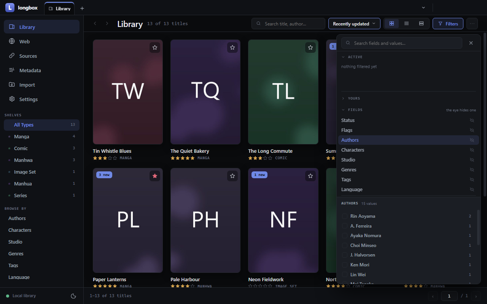

# longbox

**A local-first desktop vault for manga, manhwa, comics, image sets and episodes — with a browser
built in to bring them home.**

Your library is a plain folder on a disk you choose: this one, another, or a network drive. Every
chapter is an ordinary zip with a `ComicInfo.xml` inside, every episode is the video file it
arrived as, and what longbox knows about a title is readable JSON beside it. A SQLite index keeps
it fast and is rebuilt from the folder whenever it has to be. No account, no cloud, no server to
run: install it, point it at a folder, read.

[Download](https://github.com/witalic/longbox/releases/latest) ·
[Project page](https://witalic.github.io/longbox/) · [User guide](docs/guide.md) ·
[Changelog](CHANGELOG.md)

## What it does

- **A library you can filter by anything** — a cover grid, a dense list or detailed rows; facets
  for type, status, genres, tags, languages, authors, characters, studio and fields of your own,
  each value included or excluded; a page for every author, studio, tag or character with their
  works.
- **A browser that captures** — open a title's page in the built-in browser, click the elements
  that hold its title, authors, tags and cover, and longbox remembers how that site is laid out for
  the next title. Arm a chapter and download its file, or capture its pages as you read them. Ad
  blocking included; the **Sources** page keeps the sites you use in your own groups and order.
- **Your folders, imported** — say what each level of a folder tree means and longbox files it,
  showing exactly what it will create before anything is written.
- **Metadata at scale** — rename, merge or move values across the whole library with a preview
  and an undoable history; rules that tidy values on their way in.
- **A reader and a player** — page and strip modes with per-title settings; episodes with
  subtitles and resume points, and playable copies (made with the bundled ffmpeg) of files a
  browser cannot play.
- **A vault you can trust** — every stored file checksummed, a health check that says what is
  broken, missing or stored twice, atomic writes, and several vaults, each complete in itself.

The [user guide](docs/guide.md) describes each in full.

## What it is not

longbox ships **no content and no code for any particular website**. There is no catalog of
sources, no built-in scraper, no online metadata service and no tracker sync — by design. The
recipes it captures with are the ones you make, for the sites you choose to visit. What you keep
in your vault is your responsibility: respect each site's terms and the creators' rights.

## Install

Builds for Windows, macOS (Apple silicon and Intel) and Linux are on the
[releases page](https://github.com/witalic/longbox/releases/latest). Nothing else is needed —
Python and Node are only for working on the source.

The builds are **not yet signed with a paid certificate**, so the system warns once, on the first
launch:

- **Windows** — `longbox-X.Y.Z-windows-x64.exe` (installer) or `…-windows-x64.zip` (portable).
  SmartScreen says *Windows protected your PC*: choose **More info → Run anyway**.
- **macOS** — `longbox-X.Y.Z-macos-arm64.dmg` (Apple silicon) or `…-macos-x64.dmg` (Intel). The
  app is ad-hoc signed but not notarized. On macOS 15 and later, open it once and dismiss the
  warning, then choose **Open Anyway** in **System Settings → Privacy & Security**. On earlier
  versions, right-click the app and choose **Open**. If macOS calls the app *damaged*, the
  download is quarantined: run `xattr -dr com.apple.quarantine /Applications/longbox.app`.
- **Linux** — `longbox-X.Y.Z-linux-x86_64.AppImage` (make it executable with `chmod +x`) or
  `longbox-X.Y.Z-linux-amd64.deb`.

`rar` archives need `unrar` or `bsdtar` on the machine; every other format is handled inside the
app. Signed builds are the first thing donations would pay for.

## Privacy

There is no account and no telemetry, and the app checks for nothing by itself. The only requests
it makes without you asking are:

- the ad blocker's filter lists — EasyList, EasyPrivacy, uBlock Origin's filters, Peter Lowe's
  list and Fanboy's cookie list — fetched from where they are published, every four days (the ad
  blocker can be switched off);
- your sources' site icons, from Google's favicon service, which is told each site's domain.

Everything else — every page, download and image — is something you opened in the built-in
browser.

## How it is built

longbox is designed, directed and tested by one person, [witalic](https://github.com/witalic),
and written largely with **Claude Code**, Anthropic's AI coding assistant. The owner decides what
is built and how it should behave, tests every change in the running app and makes every release;
the assistant writes most of the code, its tests and its documentation. Commits it co-wrote carry a
`Co-Authored-By: Claude` trailer, and the conventions it works by are public: [CLAUDE.md](CLAUDE.md)
and [.claude/rules/](.claude/rules/). Nothing lands without the offline test suite (600+ tests),
the type-check and a build passing.

## Contributing

Bug reports and ideas are welcome in [issues](https://github.com/witalic/longbox/issues). To work
on the source — setup, checks, conventions and how releases are made — see
[CONTRIBUTING.md](CONTRIBUTING.md); for how the app is put together, [ARCHITECTURE.md](ARCHITECTURE.md)
and [design/state-model.md](design/state-model.md).

## License

longbox is free software: you can redistribute it and/or modify it under the terms of the
[GNU General Public License](LICENSE), version 3 or (at your option) any later version. The ffmpeg
build bundled for playable copies is GPL v3 as well; its notice and where its source is are in
[packaging/licenses/FFmpeg.txt](packaging/licenses/FFmpeg.txt).
